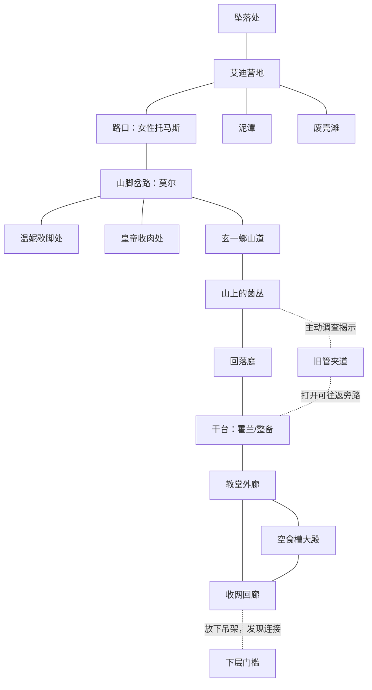

# 《腐蚀世界》三天 Vertical Slice：攀高者与空餐桌

> v0.6 / 2026-10-08。结构实验稿，不是完整游戏终稿。  
> 一句话：**一个只剩五日的坠落者沿着反复跌下山、又爬回高处的粪怪前往教堂，发现那里等待的并非救赎，而是一张失修却仍会捕捉活物的餐桌；他必须用途中学到的生存手段脱身，才能摸到继续向下的路。**

## 0. 阅读依据、权威顺序与实施边界

实际完整读取：

1. 《腐蚀世界_三天节点拆分_孢雾阀门与诱怪_VS草案_v0.5.md》。该文件明确自称待实现草案。
2. 《项目现状与业务需求落地参考_2026-10-08(1).md》。报告基准为 `main / 89c7736`，覆盖地图、行动、NPC、战斗、开发入口与34项既有逻辑检查。
3. 《腐蚀世界_NPC设定汇总.md》，含2026-10-05更新。
4. 《腐蚀世界_2026-09-28_设计共识增量.md》，含10月初五日规则及教堂更新。
5. 本轮用户给出的十条基本前提和结构目标，以及会话中可见的近期讨论摘要。
6. 可访问的 `Demo魂卡牌.rar`，实际解压检查：只有 `index.html / styles.css / game.js / deck-config.js` 和四张图片。没有 World、地图、NPC JSON、行动事件、BattleBridge、测试目录或 Git 版本信息。它不能作为89c7736的源码替代。

本轮明确指令 > 当前共识 > 可读现状报告 > 历史草案。聊天摘要只提供连续性，不能证明代码已实现。未访问到完整聊天档案或当前仓库；未把旧包套上新故事后冒称“当前项目切片”。

**本轮已完成的范围：叙事设计、逐节点规格、机器可读内容契约、静态路网与预算检查。第三步的游戏集成与真实试玩被当前源码缺失阻挡。** 内容包是设计中间格式，不是当前引擎可直接导入的JSON；必须按实际schema转换。不得用这一边界替代后面的具体落地工作量评估。

### 0.1 四类信息必须分开

| 类别 | 本轮处理 |
|---|---|
| 硬共识 | 虫人尺度、老排污/通气管道与沉积山；深度感染五日期限；仅长休换日；血肉不续命；教堂是假终点；既有卡牌/时刻/疲劳/装备/献祭；双向节点路网；NPC有限视角；温妮可传授献祭；玄一螂初见不突出面罩 |
| v0.5待实现 | 女性托马斯扩展、泥潭切肉、艾迪仿罩、逐节点孢雾侵蚀、玄一螂和温妮人物接入、霍兰互动、隐秘阀门及两处远端后果、诱怪减群等；没有源码证据能称已落地 |
| 可重组提案 | 中段冲突、教堂现场、人物迁移细节、日结时机、隐藏路线、怪群行为及高潮；本稿新增“攀高循环—残损捕食网”是一轮试验，不升级为永久世界真相 |
| 实现证据 | 双向地图、首次探索1体力、6体力、同步后完整身体66HP、长休不限营地、卡副本疲劳、行动槽、现有群战和Bridge等来自现状报告，未在本轮源码复核；新内容接入尚未验证 |

现状与设计差异：物品规则已修订：`freshFlesh` 可食用回血、交易或直接作诱饵，统一消耗一份。献祭菜单目前自动出现在NPC对话，不依赖温妮。新事件的HP/体力扣费不是任填JSON就会执行。当天事件候选缓存不能承担即时人物变化。现有克里斯、旧出口等存在不可达或未挂载问题，本切片不借用它们当保底路线。

本轮不限制“先见温妮才能献祭”，只通过她提供有动机的实践描述。保留现有身体/献祭规则，不把旧共识中眼、心的早期效果写回覆盖当前报告。血肉回血需单独接入；在接入前，任何预算只计算已有止血瓶。

## 1. 三阶段的组织方式

| 阶段 | 主角当下问题 | 玩家主要行动 | 局部高潮 | 不可逆进展 |
|---|---|---|---|---|
| 山脚：坠入与求生 | 我还能保持自己多久？上山前愿意带走什么、舍掉什么？ | 路口处理托马斯；泥潭取肉；选防护/装备/献祭；短支线 | 路口危机有结算，并让托马斯实际离开险地或留下伤痕，而不是只认识她 | 人物受伤、信任、肉块来源、已做献祭不能复位 |
| 山腰：深入与异常 | 为什么这些怪朝下滚，却还不断向上爬？我能利用这件事吗？ | 观察重复攀附；试探侧风；选择战斗、利用行为或管道绕行；建立山腰活动中心 | 玩家穿过“回落庭”，留下可见的新怪群分布或可复用的路线 | 开出的路、被处理的怪、掌握的现场规律、玄一螂的进展保持 |
| 教堂：抵达与反转 | 上面的“门”还在动，可它究竟在接什么？我怎么从餐桌脱身？ | 检验捕食遗迹；应对幸存住民；处理收紧网兜与吊篮；决定救人/取物/退避 | 从一次局部收网中脱身，将吊篮/检修架降到可踏处，获得实物与下层入口 | 确认教堂不是现成出口；完成一次设施与人物结果结算，而不是只点亮下一张地图 |

阶段依据是亲历事件，不是日期等级，也不是地图门锁。直奔者可在山腰少看证据，到教堂现学现用；回头者仍可走旧路，但旧人不会重置。主线问题依次从“找办法活着上山”变成“穿过正在重复失败的怪群”再变成“利用捕食设施活着离开教堂”。

**活动中心自然上移**：艾迪营地 → 山腰干台 → 教堂外廊。长休沿用HUD，不增加旅馆或休息点资源。干台可一次取止血瓶，霍兰在那里有独立狩猎活动；外廊可整备、折返。主线不要求山腰取物后回营地提交。

## 2. 主导悬念：攀高失败，不是逃亡

### 2.1 为什么选这条

粪怪沿用真菌寄生后的异常攀附行为。本稿只增加一条可玩的**地方性干扰**：山腰上缘残损的导网/薄帘悬在旧通气缝前，间歇侧风把攀附者从光滑铁脊上推落。它们跌下后再次攀高，旧体反复出现；坡下因此积着更多活体、碎壳与孢粉。玩家最初会把下滚误看成“逃亡”，下一次亲见相同断角个体又向上爬，开始修正判断。

这是给游戏行为写的局部规则，不是对现实虫草生态或真实DWV工程的科学断言。旧风路仍运作；不需要玩家开启全世界通风。

| 候选 | 本轮不采用的原因 |
|---|---|
| 单纯数量暴增、全面下山灾难 | 容易退化成加怪与营地防守，抢走上山目标；需要更大区域日结与平衡 |
| 粪怪逃离新捕食者 | 为中段再创造一个顶层威胁，三天难兑现；也会冲淡既有寄生行为 |
| 教堂族长期维持全岛生态，停止捕食导致失衡 | 把教堂写成世界控制中心，迫使所有NPC围绕同一危机；本稿只保留它们捕食减少的局部结果 |
| 另一层寄生者控制粪怪 | 与本体灵感重复，且用户明确反对 |
| 巨阀把孢雾转嫁山脚两势力 | 探索奖励容易变成未知永久惩罚；需要远端灾情、分流逻辑与解释，不能支撑轻量主线 |

### 2.2 开发者真相与玩家证据

| 层次 | 内容 |
|---|---|
| 本切片开发真相 | 普通攀附行为仍存在；失修网帘与侧风造成反复回落；教堂部分捕食网已脱挂，食物送达变少；残存网兜仍会被周期气流拉紧；向下的吊架通向更深管道。没有第二寄生层 |
| 玩家亲见1 | 山脚收肉点多了碎壳，泥坡偶有活体下滚；无法凭此认定增长或逃亡 |
| 玩家亲见2 | 回落庭有同一断角粪怪反复向上爬；飘带横起时，它被推离铁脊；空下来时又爬回 |
| 玩家行动验证 | 把松帘固定在路外旧支点，攀附者转向粗糙边面，路面压力下降；随意将肉扔在正路，仍会吸引游走个体，不改变已钉牢的攀附者 |
| 玩家亲见3 | 旁路内可看见风吹帘背面、脱钩残端、同样切向的壳擦痕；从不同角度补证，不给后台全图 |
| 教堂回报 | 网架上的旧空壳与断钩吻合；一条脱下的网帘一直垂向山腰；残存网兜遇同类气流收紧。玩家用相同规律解决新的险境 |
| 仍未证明 | 谁故意破坏过？更深处为何仍持续抽动？教堂传言中的“出去”是何人亲历？网架与真实回家路径有何关系？本切片不替玩家证实 |

无需“知识等级”。内部 `observedClimbCycle / observedSideDraft` 只记录是否亲见；不能给NPC共享。玩家没有Flag但主动提出正确操作时，仍允许付相应行动成本尝试；有Flag只增加合理的操作文字与低成本精确方案。

### 2.3 山腰的玩法兑现

回落庭对象为 `攀附的粪怪 / 松帘与支点 / 路外高脊`。

- 暴力→怪：开现有群体战；胜利使这批威胁消失，不能靠重访复刷。
- 暴力→帘：切断帘，当前一批怪回落到远离人路的壳坑；路面暂空，扬粉造成明确HP代价。刀切后的状态永久，后来游走体仍可出现，不恢复整套初见。
- 观察→场地：展示两个相邻气流周期，不推进日期；获得可重复验证的行为证据，观察卡正常疲劳。
- 伎俩→支点：把帘固定到路外旧钩，让攀附者转上路外粗糙脊。本地人路安全改善，但附近高脊继续有孢粉；不是灭菌救世。
- 执念→支点：承风稳住帘，付可见HP代价，得到本次穿行窗口；长休后不再维持，不能写成永久修复。
- 肉→路外壳坑：只牵走仍游走、会摄食的个体，攀附体依旧。必须先看到路外位置与投放方向；不把肉顺风导到艾迪或皇帝。
- 不解决：沿外缘窄步道硬闯，支付明确HP损失，或走已发现管道。这里从来不是所有人走不通的墙。

MVP不新写怪群AI：独特行为主要在行动场景和战前结算；群战仍使用现有意图/阵线。投饵、扶帘等直接避过本次群战，**不要求动态减怪机制**。若需要“留三只开战”，另做固定战斗配置，不偷偷修改群战对象。

## 3. 教堂方案：空餐桌，残网仍在收紧

采用“捕食网局部失修，住民困于饥饿”的缩小版本。**不定稿为古老门户失效，不定稿教堂族的最终种族/神学，也不把它们写成曾维持全岛生态的管理员。** 教堂族沿用现有世界称谓；本稿只做一名无名幸存住民和一处旧捕食设施，不增加讲解型NPC。

抵达：外廊布满被啃干净的旧壳；大殿有空食槽和已经发干的遗体，另有新鲜爬动痕迹。幸存住民守着小堆湿肉，错认玩家要夺食。它只会说断续宗教用语，例如“还会赐下来”“别碰它”，这代表它的理解，不认证旧机构是神迹或出口。

玩家可：把一份新鲜血肉放在可见的食槽，换取暂不攻击；用已学的伎俩转移注意；以献祭身体引起迟疑（只改变态度，不自动解开设施）；或战斗。不给肉亦能退回外廊，沿破侧廊去收网回廊，省资源者承受一次明确的伤害代价。

### 3.1 高潮：过路者也会落上餐桌

回廊的一段吊架被旧网兜拖偏。玩家从上缘踏过时，**先可见**它的晃动、被勒住的旧尸和来去气流；交互前显示风险与退路。玩家可以观察后操作，也可决定冒险取物。一次收紧将主角与另一个被挂住的对象牵向食槽，触发单场行动困境。不是无预警剧情绑架，且不需新战斗系统。

挂住对象依此前状态确定：

1. 托马斯被劝上山且带着实物防护/可走路线，已经到教堂：她在另一侧小架上，慌乱拉扯。若没有足够准备，她在干台止步，不凭空传送到这里。
2. 否则玄一螂在Day3+登山，且未死亡：他带伤挂在另一侧，但仍试图切开自己一边的网。
3. 否则是一具无名旧尸。**无人可救仍完整成立**，不能强行生成等待主角的活人。Day1速通不靠NPC后来剧情才能触发高潮。

输入及结果：

| 输入 | 当下可见行动 | 对主角 | 对另一侧对象 | 设施/后续 |
|---|---|---|---|---|
| 已见侧风 + 伎俩，或观察后伎俩 | 趁网兜松回时将余绳套在固定环，不碰承重主绳 | 低损耗脱身 | 活人可一起降到踏台；尸体保留可搜 | 局部吊架归位，露出检修入口与磨亮的下行绳 |
| 执念 + 可用固定物/已内化防御 | 顶住收紧，让另一侧先落到平台 | 明确HP代价；疲劳或内化按既有规则 | 可救活，但伤势不自动治好 | 吊架卡住，入口仍可踏入；不是恢复整座教堂 |
| 暴力→副网/定位已明 | 切断非承重缠网 | 中等HP损耗 | 对象随架落到低台，需后续处理伤势 | 入口露出，但网具无法再用 |
| 暴力→主绳 | 场景事先说明“另一侧只靠这根绳吊着” | 快速脱身 | 另一侧坠落；不隐藏这项风险 | 绳断后能从残架进入下层；较差局部结果 |
| 无卡、无物、全疲劳 | 沿锈边磨断自己侧缠网，再攀回踏台 | 支付较高且已显示的HP损失 | 对象留在原处；不自动杀死，之后仍可救 | 重访保持困境已逃脱；入口需再完成一次放架动作 |
| 放弃取物 | 退回外廊/破侧廊 | 少量已显示擦伤或无损（未进入时） | 不变 | 能折返；不结算阶段完成 |

没有“必须观察才允许猜中”。未经观察也可选套环方案，但需先花一次观察/试探动作认出副绳与主绳，增加疲劳，不依赖唯一卡。最低保底靠可见锈边和HP，HP不足时允许在困境进入前退到外廊长休；已陷入时不让长休消掉困境。真正死亡照已有World规则。

**高潮完成条件**：主角脱身 + 吊架到可踏位置 + 实际拿到一段从下方磨出的绳端/检修钩 + 看见沿绳可下行的入口。不能仅凭“发现下一节点”写 `sliceComplete`。

最后的画面：食槽上方那条想象中的上升通路被干涸泥壳封满，磨亮的牵引绳却从下方来；下一阵响声在更深处先出现，然后大殿网兜才抖动。**新问题是“下面是谁、或什么，还在牵动这张餐桌？它知道另一条出去的路吗？”** 只设后续问题，不在本稿锁定厄运的终局目标。

### 3.2 较好结果的因果

救下活人后额外交止血瓶，或此前已经给过同等有效处置，才让其状态成为“可自主撤离”，否则只是“活着、仍需帮助”。住民是否有一份食物与是否继续争夺资源分开结算。救人不给善恶点、不凭空发神器。

回落庭若把帘固定在路外、吊架又稳妥放回踏台：**山腰这一条行人路的回落冲撞减少，教堂这一处检修路径可双向走，至少一名带伤者能沿它离开**。仍有孢雾、其他捕食网、饥饿住民和五日期限。玩家改善一小块世界，不接管生态。

## 4. NPC独立行动轨迹

日结从开局运行，未访问地区也结算。先检查死亡/离场，再执行一次迁移，最后演化伤势；不能先迁移死人再覆盖初见。

| NPC | 独立动机与已持续的事情 | Day1初始 | 第一次长休 | 第二次长休及后续 | 玩家能改什么 |
|---|---|---|---|---|---|
| 艾迪 | 打捞、维持营地，不想再上山；局部收肉点经常被游走怪占据 | 接纳新人，忙于分拣旧壳；不送肉 | 先前堆在正路的碎壳若未清，打捞点收缩，不是营地自动灭亡 | 物资有限，仍可协助制作；活人来营地要有容身方式 | 清路外收肉点/托马斯承担分拣/给防护材料能改善一处作业，不会延长感染 |
| 女性托马斯 | 怕痛怕死，想依附一个可信的人 | 路口求救，危机确实结算 | 未处理则自己逃到营地边，留伤与怨气；营地方案已定则开始打捞；登山方案则走至干台 | 未获处置的伤势加重；无容身方式者可能接受皇帝庇护；准备不足的登山者停在干台，不强行赴死 | 救援方式、具体去向、实物防护/药、是否提供已观察的路况；到干台仍可改变主意 |
| 温妮 | 享受获得的力量，也利用弱者；不是免费神官 | 山脚歇脚点展示收益与缺损，按交易/示威动机传授 | 仍在自己活动区，不因主角上山消失 | 改为处理皇帝手下交易的文本；不新增任务链 | 获得实践描述与一项人格影响，献祭仍自愿；不见她不锁主线 |
| 玄一螂 | 已有上下山经验，准备最后一次深入，拒绝献祭 | 普通山道擦刀休整；不强制特写罩具 | 自行到干台准备，不再永远在初见点 | Day3到教堂外缘受伤；Day4未获帮助则伤情恶化/撤退，死亡分支需有可见伤因，不能仅按到区判死 | 玩家能提前挑战、交流、防护取舍、给药；不能把他的通行能力写成依赖主角 |
| 小皇帝 | 保住权威、收贡和囤肉；对威胁过度反应 | 有自己的守卫、作业点和藏肉处 | 收肉处把游走怪吸到皇帝附近；他加派人并继续压榨 | 若尸肉移离人路，压力降低；若死了守卫则作业撤缩，仍不是全岛失控 | 可贡肉取物、羞辱冲突、移开废料；无须杀皇帝，VS不制作大规模攻寨 |
| 莫尔 | 卖有用的路况、隐瞒不利事实，收两边的钱 | 山脚岔路卖“靠铁壁的旧走法”，知道旧路径，不保证它今天干净 | 改卖山腰最新见闻或回收丢下的物件 | 不因玩家验证骗局就自动悔改；玩家能当面指出某条消息过时 | 情报价格、可信度、托马斯的依附；不认证阀门/出口真相 |
| 霍兰 | 找值得打的对手，靠战斗取食；去留按狩猎，而不是守主线钥匙 | 可能已在干台整理战利品；不必等Day2才见 | 去旁侧狩猎，留下砸扁壳与对照痕迹 | 回干台或继续上行，按局部旗标，留痕替代等待；不必安排教堂助战 | 尊重玩家正面战绩，允许借经验/换封缝物；完整决斗与厄运线本轮可砍 |

NPC不能凭 `observedSideDraft` 自动知道玩家曾去哪。托马斯获路况需要玩家实际选“告诉她刚看见的反复攀高”；玄一螂评论新伤需要亲见或玩家主动说明。原世界人类履历沿用人格背景，现场身体尺度与描写统一虫人。

### 4.1 第一阶段可完成人物事件

路口不以“把她救下来，以后再说”结束。危机解除后，玩家至少能：

- 明确告诉她营地的位置与打捞的活计。她沿已存在的安全小道去营地，地图重访可见人已迁移；玩家不需要护送传送或递交任务。
- 告诉她自己要上山，她决定先跟到安全的干台。是否准备好不会由一句鼓励解决。
- 索取报偿/取她身上的物件，关系进入依赖或敌意，不给通用关系数值。
- 把她留在原地并离开，长休后看到自行撤离的痕迹与伤势。

得到的是一次完整的“遇险—解决—选择下一步—现场离场”，第二、三阶段再回响。没有唯一正确人生结局。

## 5. 地理拓扑、叙事状态、认知状态

17个首次意义节点，其中起点已探索、无需再付费；16个新访点。地理层中 `slice_lowfork` 不是空连接点，它承载莫尔与地方收肉线的选择。

拓扑图表达空间，不代表强制事件完成链。玄一螂所在位置就算人物已走仍可过；回落庭可绕边、战斗或走夹道；大殿可跳过。没有人物存活、面罩、皇帝许可、固定日期才能激活的主线路。

### A. 地理状态

- 所有普通边持续双向开放。初访1体力，已探索安全点重访0体力。
- 地图揭示沿父子逐步出现，不改变NPC既往通行史；NPC原本认识的路无需由玩家点亮。
- 菌丛与回落庭有进入侵蚀；每次实际跨边都结算，打开面板不结算。自动寻路逐段执行，危险段必须显示预计损耗；不许从山脚点教堂无损跳过。
- 夹道需实际发现、清掉一处可见松层，随后菌丛↔干台双向可走，绕过回落庭。既不是分流阀，也不转嫁任何远端灾害。
- 下层入口通过实际放下吊架显露。它此前存在于世界，不是凭Flag生成的新地形。无需让所有原住民一直不知道下面有路，切片只证明主角看见了它。

### B. 叙事状态

- 路口危机一次性；托马斯迁移后原地留下被弄坏的支点/小物，不能再领初见奖励。
- 艾迪打捞范围、皇帝局部收肉处、人物伤情按长休演化；未参与也有合理变化。
- 首次穿过回落庭写 `passedMidSlope`，只更新主角当前目标/回访口吻，不删山脚支线，不触发全体NPC死亡。
- 切帘、杀怪、给药、取材料持久；执念扶帘和单份诱饵只给当前一次穿行机会，过后按场景状态回到仍可观察的危险，不倒带角色事件。
- 一次性材料与止血瓶防刷。长休清疲劳，但不刷资源、不重置设施，不自动完成“修理”。

### C. 认知状态

- 首次泥潭尸体只知道“肉有用途，尸体不安全”；重访见壳上附白丝与被搬过位置，不自动知道菌类物种或完整死因。
- 在山腰亲见回落循环后，山脚碎壳位置有新意义：玩家能说“这里会堆东西”，并将废料移离人路，改善打捞/收肉点。
- 在教堂亲见脱钩残网后，回落庭支点有新可见操作：按同样挂钩方式固定帘。事先摸索已经成功者无需重复学习；不能靠隐形知识等级拒绝聪明玩家。
- 夹道的背面观察使教堂绳网操作更省损耗，但不是唯一入口钥匙。快速玩家可在回廊现场观察/试探得到保底证据。

## 6. 跨节点因果，彼此有关但不全围绕同一灾难

| 因果组 | 起因 | 中间条件 | 后续可见回响 | 可改善行动 |
|---|---|---|---|---|
| 托马斯的人生策略 | 路口保护/弃置/索取，以及选营地或登山 | 真实准备：一份药、实际防护或已获路线；口头鼓励不等同准备 | 营地分拣者、干台止步者或教堂同行者；她会感谢、责怪或另找庇护 | 给药、建议停止攀登、分享已验证旁路；活人可改变主意 |
| 地方收肉与安全 | 皇帝正路堆放碎肉与废壳；艾迪作业点相邻路段被游走体占用 | 是否把废料搬到无人壳坑，而非转嫁营地 | 第二日守卫加派/打捞收缩；合理清理后减少一次局部威胁 | 实际搬移废料、隔开作业位、托马斯承担分拣；不需消灭势力 |
| 山腰规律→教堂脱身 | 观察侧风、固定帘或从夹道观察背面 | 玩家将亲见规律应用到松回网兜与固定环 | 同样条件下，低损耗套环 vs 高损耗磨断；断网/稳架场景不同 | 在教堂现场补观察；无需折返山脚拿钥匙 |
| 玄一螂的独立登山 | 初见已准备上行，第二日迁移 | 死亡、给药、是否有更安全通路 | 干台/教堂带伤状态、遗体失物、空山道；来源不同的罩具 | 提前给药或在教堂救下，不凭面罩Flag自动治伤 |
| 艾迪试制与劳动 | 废壳滩取得韧膜、一次试制 | 实际穿戴才防护；试做是否亲自验证 | 玩家受蚀减少；回营地时艾迪根据玩家报告调整一处作业罩布 | 多留一片材料用于作业位，不能无限复制装备；非必返任务 |

地方清理只影响指定收肉点。是否关心小皇帝不影响回落循环、教堂气流或下层入口。温妮主要影响玩家身体与托马斯价值观；不强迫她参加设施危机。

## 7. 逐节点实施规格

共同约定：起点成本0，其他首次进入1体力。重访安全点0；战斗首次随探索触发时复用已付成本，重访主动挑战按现有1体力。新增事件额外成本必须在World具名接入。实际用了卡副本才疲劳；匹配失败不扣卡/物/体力。对象只在已观察后使用更具体名字。所有“成功”均指对应行动，不等于道德正确。

### N01 `start` — 坠落处

- 连接：`eddie`。初始已探索。进入：开局；成本0。
- 可见：污水、虫甲呼吸缝上的白絮、高处模糊建物；主角不知道门户机制。系统传达五日硬期限，NPC不精准授课。
- 交互：检查自己/锈剑/止血瓶；前往营地，不新增资源。
- 成功：进入生存流程。失败：保留World死亡。放弃：可停留，无现实计时；重访：坠落痕迹与水位局部变化，不补初始物。
- 读：日期/身体。写：无剧情真相Flag。不可跳过开局位置；可跳过说明。现状：地图说明/文案调整。

### N02 `eddie` — 艾迪营地

- 连接：`start / node / slice_mudbank / slice_salvage`。初访揭示路口与泥潭；主动询问或现场搜寻揭示废壳滩。
- 可见：打捞作业、有人存活的痕迹；艾迪仅提供听来的上山希望，不送肉、不谈血肉延寿。
- 输入：交谈；带韧膜试做；交新鲜血肉换一次止血瓶；查看已迁来的托马斯；已有身体菜单继续保留。
- 成功：一次试做消耗材料，得到粗糙鸟嘴整套防护，装备后才生效；交易一次。失败：材料不足不扣；艾迪死则无制作/交易。放弃：不损主线；重访：作业收缩/改善、托马斯去向、验证后对话，旧奖励不重发。
- 读：`eddieDead / wrapMaterialTaken / thomasPlan / localWasteMoved / wrapTested`。写：`eddieWrapMade / eddieTradeDone / eddieWorkProtected`，配套物品。可跳过互动，不要求返回提交。配置+物品保护与后果接入。

### N03 `slice_mudbank` — 泥潭

- 连接：`eddie`。初访1；无危险侵蚀。可见：一具冲来的坠落者尸体、泥、水；不自动证明死因。
- 槽：`尸体 / 缠住的纤维 / 泥水`。暴力切割直接获得一份 `freshFlesh`，可食用、交易或作诱饵；伎俩抽取外层韧膜/布纤得一份 `mistWrapMaterial`。取肉与取膜规则以新版节点报告为准，不新建材料碎片系统。观察给腐物痕迹而非完整真相；“新鲜”是物品形态，不认证没有感染。
- 成功：一具尸体只取一种资源，选择前说明诱怪、交易/供食、试制防护的用途；不能一尸反复榨物。失败：错目标不扣；强拽付已显示擦伤，但仍能离开。放弃：完整保留；重访：尸体附丝与取过部位变化，无新奖励。
- 读写：`mudbankHarvest`=`none/flesh`。可跳过；鲜肉也可由实际击杀武士取一次。新action JSON+一次性奖励。

### N04 `node` — 路口的喘息（女性托马斯）

- 连接：`eddie / slice_lowfork`。入场1；未解决可离开。场景：她卡在低坡，游走粪怪逼近，场地支点可操作。
- 槽：沿用 `托马斯 / 粪怪 / 场地`。攻击怪先手（沿用4刻延后）；执念护人；伎俩/暴力场地改变逼近；肉诱至明确路外；暴力人是伤害/杀人，不包装救援。
- 成功：危机结算后选择具体下一步，迁往营地或预备登山；不强迫领取卡。失败：拼杀Lose死亡、Escape留下威胁/伤情；无效配方不扣；未处置长休后她自行撤走留伤。
- 放弃：能沿边走，不强制清怪；重访：事件已结算则展示损坏场地与人物去向。读：死亡、事件状态、物品；写：`thomasAlive / thomasRescue / thomasPlan / thomasPrepared / thomasWound`及人物位置。可跳过处理。复用既有遭遇，新增迁移/日结/女性文本。

### N05 `slice_lowfork` — 山脚岔路（莫尔）

- 连接：`node / node3 / slice_winnie_stop / slice_emperor_yard`。初访1；无额外搜寻税。
- 可见：左右作业声、散落碎壳、往上可走的路。莫尔卖亲走过的“贴铁壁走法”，但那是过去状况；不揭阀门地图。
- 交互：花肉换一次旧路线提示；观察碎壳来源；向他质询验证过的消息；听/不听都可上山。提示只给菌丛铁壁方向，隐藏夹道仍需主动操作。
- 成功：`morTipBought`；失败：支付不足不扣，消息过时允许回访质询，不能判玩家自作自受；放弃：自由；重访：销售话术随事实变化。
- 读：`observedClimbCycle / emperorWasteMoved`。写：`morTipBought / morChallenged`。全部互动可跳过。NPC JSON+普通配置。

### N06 `slice_winnie_stop` — 腐壳间的歇脚处

- 连接：`slice_lowfork`。初访1。可见：温妮的缺损与能力，主动互动才进一步观察；不安排神官。
- 交互：询问代价/步骤，交易或被她挑衅后见示范；使用现有献祭菜单时明确永久代价。`winnieSacrificeTaught`是经验来源，非全局献祭钥匙。
- 成功：获得有限实践描述；可拒绝献祭。失败：未付交易不扣，出言冲突改变口吻不锁主线；放弃：无后果；重访：已教过不重复奖励，身体变化由她能看见的部分回应。
- 读：实际献祭与本人见闻；写：`winnieSacrificeTaught / winnieDealDone`。可完全跳过。新NPC JSON与挂载，不改身体系统。

### N07 `slice_salvage` — 废壳滩

- 连接：`eddie`；由询问或营地主动搜索发现，同一途径只揭示，不额外探索收费。初访1。
- 可见：外脏内较干净的空壳、压着的韧膜、织纤。不是认证抗孢材料。
- 槽：`压壳 / 织纤 / 小游走体`。暴力撑开壳、伎俩抽膜、执念护住手，各付卡疲劳；可小战但本轮优先只做可见HP取舍。
- 成功：一次取 `mistWrapMaterial`；材料可用于艾迪仿罩或营地作业位，选择前说明互斥。失败：错误用力擦伤并保留可再试材料，不随机摧毁唯一资源；放弃：能回头；重访：已取空壳，无刷新。
- 读写：`wrapMaterialTaken / materialUse`。可跳过；无艾迪仍可取得但不能自动会制作，硬闯/其他罩具路线保底。新action+物品登记。

### N08 `slice_emperor_yard` — 皇帝的收肉处

- 连接：`slice_lowfork`。1体力。小皇帝在场或以守卫行动体现其权力，VS不做完整据点图。
- 可见：碎肉堆在人行路旁，引来游走体；贡物与呵斥。此前已经持续，不因玩家才出现。
- 输入：用伎俩把废料搬入明确无人壳坑；暴力威胁守卫（可战斗，列为可砍）；拒绝并走。
- 成功：`emperorWasteMoved`降低该点次日威胁；交易只一次。失败：挑衅失利消耗/敌意，不关闭上山；放弃：地方威胁继续但势力仍生活；重访：加派、撤缩或较平稳作业。
- 读：日期/托马斯依附；写：`emperorWasteMoved / emperorHostile`。可全跳过。配置与局部日结；不实现势力数值。

### N09 `node3` — 玄一螂山道

- 连接：`slice_lowfork / slice_fungus_edge`。1体力；人物离场不消失地理连接。
- 可见：武士擦刀、休整或空歇脚处；初见默认叙述不关注鸟嘴罩。随后直接揭示菌丛，不插防护门。
- 输入：交談、主动细察、说出受蚀经历、给药、挑战；不要求挑战才能继续。
- 成功：由他有理由知道的伤情触发个人防护经验；击杀确实死亡后一次拾旧罩与一份新鲜血肉，胜利不能包装成无代价切磋。初见可给他留下一瓶药作登山补给；只有实际治疗/他自行用药处置后来伤势才写治疗状态，不能把赠物直接等同预先治愈。失败：Lose死亡，Escape无掉落；放弃：可过；重访：按独立迁移显示本人/遗留物。
- 读：`genichiroAlive / genichiroLocation / genichiroSawPlayer / mistFirstExposure`，后者只描述玩家；写：见面、玩家主动告知、给药、死亡和Loot状态。可跳过人物。新增NPC与战斗接入；完整挑战可后补但不能声称已存在。

### N10 `slice_fungus_edge` — 山上的菌丛

- 连接：`node3 / slice_climbcourt`，隐藏后连接 `slice_pipe_seam`。初访1；每次真实进入基础侵蚀3HP，实际穿戴整套罩具免普通侵蚀；数值待实玩调。
- 可见：甲缝刺痛、从上缘滚下的活体又挣向高处、铁壁缝。不能初见直接命名规律。
- 输入：观察铁壁，伎俩/暴力清松层；这一步搜索额外1体力，显示后再提交；揭示夹道。无特定卡也可借锈剑缓慢清理，付明确HP/体力；已搜过不再收费。
- 成功：`pipeFound`；受蚀实际写 `mistFirstExposure`；失败：资源不足不扣不推进，侵蚀归移动而非反复开面板；放弃：可上/返；重访：留开的缝与已观察行为，无初见重置。
- 可跳过搜索；节点必经且物理通行不锁。需要区域伤害移动钩子、发现后果。

### N11 `slice_climbcourt` — 回落庭

- 连接：`slice_fungus_edge / slice_drybench`。初访1；每次进入4HP侵蚀，防护抵消普通侵蚀。
- 可见/输入：第2节。观察两轮不推进日；切帘/扶帘/固定支点/肉投路外/群战/外缘硬闯。
- 成功：固定帘长期改善该步道；胜利清本批怪；投饵/扶帘只避本次遭遇，获得一次通行令牌，移动到下一安全点后消费，不能积攒。`passedMidSlope`写在实际抵达干台。
- 失败：Lose死、Escape保留伤与威胁；错误操作先给场景反馈、不无声把肉吞掉；放弃：可退/硬闯/旁路。重访：现设施状态；重新侵蚀但不复演危机或刷新奖励。
- 写：`observedClimbCycle / observedSideDraft / curtainMode / courtSwarmCleared / courtPassToken`。可从夹道跳过。新增action与具名战前后果，沿用群战。

### N12 `slice_pipe_seam` — 旧管夹道（隐藏捷径）

- 连接：菌丛↔干台；发现后永久双向。初访1，搜索体力已在菌丛结算，不二次收“开路税”。无普通孢雾侵蚀。
- 可见：狭窄检修夹层、帘背、断挂钩、向上擦壳痕迹，远处风吹时影子反复经过；不见全球管网布局。
- 槽：`卡住的壳 / 背面挂钩 / 通向干台的缝`。观察获另一角度证据；伎俩撬壳，执念稳穿，暴力扩大缝（扬尘4HP，事先显示）。都可通，不要求已有知识。
- 成功：出口连接揭示，得到 `observedSideDraft`；一次拾一份封缝物或止血瓶的固定小奖励（具体只选一种，MVP选止血瓶，取后不再在干台重复发）。失败：放弃可原路返；体力不够不能强扣；重访：免费快速绕危险，不复原壳堵。
- 读：`pipeFound / pipeOpened / upperPotionTaken`。写：`pipeOpened / observedSideDraft / upperPotionTaken`。可全跳过。配置+观察后果；奖励是真节省侵蚀/战斗，绝无远端永久罚。

### N13 `slice_drybench` — 山腰干台

- 连接：回落庭/夹道/教堂外廊。初访1，安全；实际到达即写山腰已穿过，无日期锁。
- 可见：可坐的干壳、砸扁怪壳、霍兰的战利品或离去痕迹；不凭尸骸指名凶手。也可见迁来的玄一螂/托马斯，互相有自己的行为。
- 输入：与霍兰换经验/封缝物；承認/吹嘘战绩（只读实际世界已发生战绩）；给伤者药；建议托马斯停下或分享确实观察的路。一次止血瓶在这里与夹道共用同一来源：从夹道先取后此处只见空物位，不凭空消失两份不同瓶。
- 成功：整备、一次资源、确认下一目标是教堂；失败：不交易不阻路；放弃：自由；重访：人物日程继续、已取物不重发。
- 读写：`passedMidSlope / upperPotionTaken / thomasPrepared / thomasPlan / genichiroTreated / hollanRespect`。主路或夹道均到此。NPC挂载+日程位置；无新休息设施。

### N14 `slice_church_approach` — 教堂外廊

- 连接：干台/空食槽大殿/收网回廊。1体力；安全整备，保持往返。
- 可见：旧空壳、干遗体、网帘挂点，与山腰痕迹部分吻合；不自动揭真出口。
- 输入：沿网帘追看断口，观察一阵与山腰相似的横风；交谈/给药迁来人物，选大殿或破侧廊。
- 成功：`churchReached / churchNetObserved`；失败：无锁；放弃：能下山；重访：已解决回廊后绳架位置不同、伤者留/走/死结果保持。
- 读：人物迁移/设施状态；写：教堂亲见与见闻。可跳过详查，主线路径必经。普通事件配置+状态变体。

### N15 `slice_church_nave` — 空食槽大殿

- 连接：外廊/回廊。1体力。可见：空桌、旧死者、少数残存湿肉与饥饿守食者；死因不通过一句观察定论全部饿死。
- 槽：`守食者 / 湿肉 / 网架下的路`。给新鲜肉、伎俩转移、献祭外观引起迟疑后对话、攻击开战；可直接退回外廊绕侧廊。
- 成功：一次通行/局部食物稳定；杀者结果保留，没人成为讲解机器。失败：Lose死，Escape回外廊、留消耗不发奖励；放弃：可绕；重访：肉量/尸体/戒心随已经结算的行动，不能重复赠肉得奖励。
- 读写：`churchResidentState / churchFoodGiven / churchResidentPassed`。可完全跳过。新action+现有单体类型的新敌数据，不新技能系统。

### N16 `slice_catchgallery` — 收网回廊

- 连接：外廊/大殿，放架后↔下层门槛。初访1；走外廊破侧廊而未经过大殿，额外擦伤4HP事先提示；这个成本是路线，不是重复开面板税。
- 可见：第3节高潮警示与对象；角色替换由实际位置与存活决定，不读取“玩家心里选了谁”。
- 槽：分阶段 `缠网 / 固定环 / 另一侧吊架`。支持观察、伎俩、执念、准确切副网、危险切主绳、最低HP脱身与退路；正常放架方式不要求救人。
- 成功/失败/放弃：按第3.1表；真Lose/HP<=0死亡。放弃取物可退，已陷入要脱身才能退，不能长休抹困境。重访：保留网具损毁、人物伤情、待放架状态，无无限奖励。
- 读：`observedSideDraft / thomasLocation / genichiroLocation / *_Alive / *_Treated`。写：`galleryEscaped / galleryMode / galleryOtherOutcome / galleryLowered / maintenanceHookTaken`，入口物只一次。
- 不可跳过高潮达成本切片结尾，但可任何时候放弃冒险折返；不是世界地理封锁。新增分阶段action与局部后果，不碰战斗UI。

### N17 `slice_pipe_threshold` — 下层门槛

- 连接：已放下回廊，永久双向。初访1，无新增侵蚀；无需Day3。
- 可见：磨亮绳端由下而来、更深处先响、上层随后抖动；实物检修钩与绳痕指向可继续的空间。
- 输入：检验钩和绳端、回看此行改变了什么、选择继续深入（本切片不含）或返回。不会把未见过的山脚结果写成全知结局字幕。
- 成功：只有 `galleryEscaped && galleryLowered && maintenanceHookTaken` 写 `sliceComplete`；活人结果与设施结果分别展示。失败：证据未齐不能自动完成，但提示具体尚未做的可见动作；放弃：自由；重访：保持尾声、允许走回地图，不强制全局结局封输入。
- 读写：上述三项/亲见记录/`sliceComplete`。完整片段结尾必访。普通事件+阶段完成结算，不能调用旧真正出口函数。

## 8. 状态契约与日结最小实现

没有新数值关系条、浓度模拟、知识等级、任务系统。17点内容用枚举/布尔与既有物品即可。

| 状态 | 默认 | 写入/读取 | 生命周期 |
|---|---|---|---|
| `thomasAlive` / `genichiroAlive` | true | 真死亡时写；所有对话/迁移/高潮对象先读 | 本局，死亡不因长休复活 |
| `thomasRescue` | unresolved | 路口结果；次日读 | 本局 |
| `thomasPlan` | none | 路口、干台主动改计划；日结读 | 本局，活人可改 |
| `thomasPrepared` | false | 真交药/防护/已验证路线，不由空话写；迁移读 | 本局 |
| `thomasWound` | none | 遭遇/日结/处置，阶段none/minor/serious/treated | 本局，治疗不复活 |
| `thomasLocation` / `genichiroLocation` | node / node3 | 日结或具体即时迁移；NPC路由/高潮读 | 本局，与死亡不矛盾 |
| `genichiroSawPlayer` / `genichiroToldExposure` | false | 实际见面/告知；伤情对话读 | 本局，不偷用玩家见闻 |
| `genichiroAidGiven` / `genichiroProtectionLooted` | false | 真实留药/真死亡后一次取罩与肉；日结用药和战利品读 | 本局，赠药不是已治疗，逃跑不取物 |
| `mudbankHarvest` | none | 一次采集写；所有来源读 | 本局 |
| `wrapMaterialTaken` / `materialUse` | false / none | 废壳滩采集、制作、作业位处置；泥潭另用自己的首取标记 | 来源分别一次性；`materialUse`记录none/wrap/work/both，实际物品数量决定还能否使用 |
| `eddieWrapMade` / `wrapTested` | false | 制作/装备后实际进入危险区；回访读 | 本局；效果由实际装备决定 |
| `emperorWasteMoved` / `eddieWorkProtected` | false | 指定地方行动；该点日结读 | 本局，无跨势力灾害 |
| `eddieTradeDone` | false | 真实成交写；重复选项读 | 本局 |
| `winnieSacrificeTaught` / `winnieDealDone` | false | 明确示范/成交；对白读 | 本局，不锁已有献祭入口 |
| `morTipBought` / `morChallenged` | false | 真实购买/质询；对白读 | 本局，不开神秘机关 |
| `mistFirstExposure` | false | 实际受到侵蚀；玩家伤情叙述读 | 本局，未受伤不能写 |
| `observedClimbCycle` / `observedSideDraft` / `churchNetObserved` | false | 对应场景观察结果写；精确操作/回访读 | 本局，只是亲见记录 |
| `curtainMode` | loose | fixed/cut/held；回落庭呈现读 | fixed/cut持久；held离开后复 loose，不恢复别的事件 |
| `courtPassToken` | false | 诱饵/扶帘写；向干台移动消费 | 一次穿越，长休清除，不能积累 |
| `courtSwarmCleared` | false | 群战Win写；威胁读 | 本局，本批怪不复刷 |
| `pipeFound` / `pipeOpened` | false | 主动搜索/实际穿通；显示与边读 | 本局，双向奖励 |
| `upperPotionTaken` | false | 同一漂来补给物位任一侧取过；两侧读 | 一份来源，不重复赠 |
| `passedMidSlope` / `churchReached` | false | 实际抵达干台/外廊；目标文案读 | 本局，不删旧支线 |
| `hollanRespect` / `genichiroTreated` | false | 实際战绩回应/交药；对白/伤情读 | 本局，不能用致敬自动治疗 |
| `churchResidentState` / `churchFoodGiven` / `churchResidentPassed` | guarded / false / false | 大殿结果/本地日结；重访读 | 本局，死者不说话 |
| `galleryEscaped` / `galleryLowered` / `maintenanceHookTaken` | false | 真实脱身、放架、取钩；结尾读 | 本局，不等价于地图已揭示 |
| `galleryMode` / `galleryOtherOutcome` | pending / none | 高潮行动写；场景/活人去向读 | 本局，可继续救援但不能复活坠亡者 |
| `sliceComplete` | false | 三项实物/行动证据齐后写 | 本局阶段结尾，非真正回家结局 |

日期演化用**一张本切片的明确表与一个具名日结函数**，不建设通用NPC日程引擎。它在 `longRest()` 推进日后运行一次，即使地方没被访问；重复渲染绝不再跑日结。已死亡优先，玩家的即时处置优先于默认轨迹。Day4/5也要有“仍活着或已有死因”的可重访兜底，不能切片超时就拿占位剧情复活角色。

日结只改变真实世界；`seen...`亲见记录在实际到达时写。奖励、费用、物品与人物后果要在一个提交内结算，先检查资源/状态，再扣成本，最后写结果；匹配失败不给半个奖励。

## 9. 三条代表性路线与资源预算

预算按报告：起点免费，6体力/日，完整身体66HP，首次直接战斗复用初访成本，首次以外主动开战另1，搜索+1，献祭+1，长休满HP/体力/清疲劳。普通雾侵蚀暂定菌丛3、回落庭4；硬闯庭外缘额外6、破侧廊4、最低回廊脱身10，这些都要显示并实玩调参。防护不免战损、夹道扬尘、擦伤或高潮代价。

### 9.1 快速主线：不与任何可选势力交易

Day1：艾迪→路口（避战并给出/不管托马斯去向）→山脚岔路→玄一螂山道→菌丛→回落庭。6新访。不观察亦可付6HP沿外缘过庭，随后体力不足时在当前无未处理行动的安全状态长休；任何地方可休，不跑回营地。

Day2：干台→外廊→（跳大殿）回廊→下层门槛。4新访；途中一次取止血瓶。无面罩、无献祭、无温妮、无皇帝亦有可行通路。高潮现场观察或以更高HP成本脱身/放架。只有9–10个关键新访，不人为让它变三日。

“第一天直奔教堂”在叙事上成立，但按当前6体力+初访成本，从起点到教堂外廊需8次付费初访，**合法新局不能Day1到达**。若调试传送/将来体力配置增加，Day1现场依然成立：高潮另一侧用旧尸，现场可补规律，所有入口不检查日期。不能用一句“速通一天可行”掩盖资源算术。

### 9.2 正常探索：典型三日

Day1：艾迪→泥潭→路口（解除危机、安置托马斯）→岔路→玄一螂→菌丛。6新访；若先探索完当日在安全已访节点长休。视选择回艾迪试做，**这一趟只在玩家自选防护线发生**。

Day2：废壳滩1→回艾迪试做0（卡/材料成本）→再上山前自选温妮1、献祭1→菌丛重访→回落庭1（观察与固定帘）→干台1（人物回响）→教堂外廊1。基础4体力，选温妮与献祭共6。温妮在本次重新上山前访问，不把抵达教堂后折回山脚列为正常流程。穿越危险段实际扣侵蚀；不把安全寻路写成无损传送。

Day3：大殿1→回廊1→下层1，主要戏是互相咬合的场景，不需凑满6体力。按玩家的疲劳、战损与探索意愿，常规也可能Day2完成，这是合法且值得测的节奏，不锁日期强拖。

### 9.3 深入探索：完整17节点，仍可压入三日

示例六/六/六预算：

- Day1：艾迪、泥潭、路口、岔路、温妮、废壳滩 =6；材料当日回艾迪加工，不额外体力。
- Day2：皇帝收肉处、玄一螂、菌丛、夹道、干台 =5，加菌丛主动搜索1 =6。
- Day3：回落庭、外廊、大殿、回廊、下层 =5，加一次献祭1 =6。

16次付费新访+1搜索+1献祭=18。群战尽量在相应首次进入时触发，复用探索成本。若玩家重访挑战、第二次献祭或多做付费行动，可能需Day4；不假称全部组合必在三日完成。深探路线先走夹道后从干台回庭观察是有意义的对照，不要求两边都清怪。

相比回落庭直行，夹道新访+搜索的首次体力投入更高1，但往后每次往返绕过回落庭4HP侵蚀与尚存威胁；多次利用更值。即便不往返，也获得背面观察与固定药品来源，奖励不只有故事文字。

战斗上限控制：路口群怪、回落庭群怪、大殿单体为3个主要战斗机会，皆可变化/避战；玄一螂挑战作为第4个可选高风险战斗。皇帝守卫和霍兰决斗先砍，避免内容膨胀。

## 10. 世界结果不是一条善恶轴

| 组合 | 人物 | 山脚 | 山腰 | 教堂 | 玩家的代价 |
|---|---|---|---|---|---|
| 局部较好 | 托马斯有容身/准备；挂住活人被放到踏台并实际获处置 | 一处作业废料移离人路，仍有势力压迫 | 帘固定路外、旁路已开 | 吊架稳妥放下；住民获食或被避开，未必喜欢主角 | 多探索、交药/材料、卡疲劳；不一定战力最强 |
| 普通 | 托马斯停在干台或在营地带伤；玄一螂按自身轨迹上行 | 作业收缩但营地未毁 | 怪被击败/仅临时引走，雾依旧 | 主角以较高成本脱身，留下损网 | 战损和少量补给，仍达到完整阶段结尾 |
| 较差 | 鼓励却未准备，托马斯怨恨；挑战杀玄一螂；或切主绳导致已知对象坠亡 | 废料仍吸怪，局部守卫/住民受伤 | 乱切帘扬粉，庭威胁未处理 | 杀守食者、断架取物，仍可进下层 | 可能得更多肉/罩具，但少同伴与安全折返条件 |
| 混合、非评价 | 托马斯留营地很好，玩家夺武士罩具；或山腰稳帘却不救吊架上的人 | 可局部改善 | 可安全 | 可能差 | 多维结果必须允许共存，不能统一成“坏结局” |

阶段尾声只呈现亲见过的结果和当前对象，不给玩家未访问势力的全知状态清单。开发调试报告可以列全状态，但不混入产品叙事。

## 11. 十项合理性自检

1. **为什么三天发生？** 设施磨损、饥饿与局部怪群反复回落已持续多日/数周。主角只是现在看见。与他同批的托马斯刚选策略，玄一螂早已在准备自己的一次登山；两条短进程在长休中发展。没有新坠落触发全世界开机。
2. **别人为何没修？** 正常山道仍能过；老手知道外缘、靠罩具、直接杀怪或另寻地形，不必弄懂帘背。教堂住民怕丢食物而不愿切网，缺体力修整；不是所有住民都不知下层。玩家只修一处，非解决千年难题。
3. **支线不接触？** 皇帝照常收肉，艾迪照常打捞；托马斯会自己逃与找庇护；温妮继续她的交易；默认局部恶化有限，不变主线天灾。
4. **Day1直奔？** 当前数值不支持无休到教堂，已明确8次付费新访；故事与条件不依赖日期，扩大体力或调试速通仍能成立，缺活人用旧尸，现场能观察。
5. **Day2返回？** 武士已迁移；路口危机不再重置；营地有伤者/分拣者，作业区与帝国收肉处有具体变化。不能凭“已到山腰”删所有旧内容。
6. **是否频繁跑回？** 防护仿制是可选一次往返；其余知识/路况/教堂操作在山腰或现场可完成。长休不限营地，干台固定补给，高潮不缺山脚钥匙。
7. **是否救世主？** 世界气流、所有山道和NPC历史通行独立；行动只影响一条步道、一个作业点、一处网架和少数人。没有“玩家修好门户全族复兴”。
8. **隐藏奖励公平？** 主动发现+清理有清楚费用；永久捷径、背面证据与一份真实补给。没有阀门未知转嫁、永久灾害或不可知坑杀。
9. **悬念兑现？** 同一断角怪反复攀高可观察；帘实际固定/切断；群战可避；教堂网兜应用同一规律；吊架和活人结果真实改变。没有靠结尾对白一次解释完。
10. **输入与输出差异？** 每个关键遭遇至少有卡系、物品、准确对象或既有身体能力的不同输入；输出包括迁移、伤情、消耗、路线、设施状态、死亡与知识，不只扣敌血。

还需真实试玩回答的风险：重复攀高是否足够醒目但不过分像谜题提示？山腰操作是否太容易？教堂自己的困境会不会抢掉玩家回家动机？人物回响是否真的在路线中碰到？三日预算是否被战斗成本或额外疲劳拖到四日？静态规格不能替试玩回答。

## 12. 与v0.5的差异

| v0.5 | 本稿 |
|---|---|
| 中段主要由腐蚀、取防护、连续怪区支撑 | 中段有独立攀高循环，观察—试探—改走法—留下局部状态的完整体验 |
| 阀门隐藏彩蛋，可能把危害分流至艾迪/皇帝 | 整条阀门灾害线撤出本切片；隐藏管道回到安全捷径与观察角度 |
| 教堂只看见更深缝道，悬念终点 | 教堂有冲突与脱身高潮，实际放架、取物、改变人物结果之后进入下层 |
| 面罩闭环较中心，可能多次回营地 | 保留两类来源与亲自验证，但防护是自选准备；山腰/教堂现场可解决核心问题 |
| 多数人物后续属于开发清单 | 最小日结明确迁移、伤势与未访问默认轨迹，并有干台/教堂回响 |
| 大量支路事件和彩蛋 | 控在17个有意义点；把莫尔/收肉选择合并到真有人/能操作的地点 |

保留：艾迪、泥潭切肉、女性托马斯、温妮传授经验、正常山道先遇玄一螂再见菌丛、初见不强调防护、鸟嘴整套罩具/艾迪仿品、有限视角、逐真实移动孢雾伤害、诱饵用途、卡副本疲劳、自由折返、教堂下层钩子、五日期限与人物基本内核。

`node12 / metalInMist` 本轮不并入主线：其现有杯声谜底与新核心无直接因果，强并会像重新摆放旧事件。可保留旧地图分支但不计切片工作量。丧钟、克里斯、玛莎、双胞胎、厄运本体暂不出场；下层可能关联蜘蛛势力仅留视觉线索，不写成已确认幕后凶手。

## 13. 接入范围、成本与可砍内容

### 13.1 优先复用

- `world-map.js`：17点、双向边、两处隐藏连接、稳定ID，主路不配置NPC/物品/日期门锁。
- `world-events.js`：确定性内容入口，人物实际状态在进入事件时读取；不依赖同日重新抽签。
- `npc-dialogues/*.json`：初见/已见/迁移/伤情/交易分支；一次性Flag守住循环赠物。
- `action-events/*.json`：对象槽、阶段、配方、观察、疲劳、`effects`基础后果；旧路口复用，其他事件各自唯一ID，不能共享已完成状态。
- 现有群战和单体技能； `BattleBridge.startBattle(enemyId, context)`；装备/献祭快照沿既有接口。
- `longRest()`：日结钩子；不新建经济、AI生态模拟、实时伤害、任务日志或存档。

### 13.2 必须局部修改代码才能成立

| 改动 | 最小工作 | 必验边界 |
|---|---|---|
| 真实移动侵蚀 | 进入危险节点钩子+实际穿戴整套罩具判定 | 单步/自动寻路/往返/逃跑/HP<=0；开背包、原地开对话不扣 |
| 新物品 | 仿罩、材料、检修钩登记；以现有头槽容纳整套罩具，不加UI槽 | 仅持有不保护；献祭头失槽时硬闯/旁路仍可走 |
| 具名后果 | 新action成本适用、帘状态、临时穿行、开管道/放架、迁移与高潮对象 | 缺资源不扣；失败/离开保留；并列配方不随机结算 |
| 本切片日结 | 明确日期轨迹与玩家状态优先的少量if/表项 | 未访问也演化；死人不迁移；同日刷新不推进；已解决事件不倒带 |
| 战后结算 | 三主战斗的Win/Lose/Escape与玄一螂Loot | 胜利才清威胁；逃跑不赠物、不让死人继续说话 |
| 场景时刻反馈 | 行动结果明确描绘两次气流/下落，不推进日期 | 可重复观察但不刷奖励；不靠NPC讲谜底 |
| 血肉恢复（独立可砍） | 若要食用 `freshFlesh`，接既有使用入口、固定恢复量与消耗 | 不改变日期、不续命；未接入就不写可食回血按钮 |

不能凭现状报告猜实际敌人JSON字段、对白action白名单、地图坐标和导出格式。拿到当前源码后先读取运行时schema及协作指引；将中间格式映射到真实schema，再加小范围具名接入。源码不足时不交“可直接覆盖world.js”的伪补丁。

### 13.3 分三次实现可验收的增量

1. **完整骨架**：起点—路口—武士山道—菌丛—回落庭—干台—外廊—回廊—下层。先能不见温妮/皇帝、无面罩硬闯；回落庭可避战；高潮能现场观察并脱身放架取钩。先不加完整NPC日程。
2. **结构反馈**：托马斯安置/准备/干台/教堂状态，武士自行上行，一条最小日结，回落庭规律→回廊低损耗操作，隐藏夹道与往返损耗。此时验证物理连通、叙事不可逆的核心假设。
3. **可选准备与地方网**：温妮、艾迪试制、皇帝收肉、莫尔质询、霍兰短互动。再做快速/常规/深探三局，调成本与文案。

优先砍：皇帝守卫战、霍兰决斗/助战、动态群体数量、深层教堂神学、厄运登场、失物生成、完整食肉系统。次级可砍：莫尔分支只留一条真旧路况+一次过时质询；艾迪作业改善只保留一个具名状态。

不可砍：山腰可操作冲突、至少一条实际捷径、托马斯至少一种后续现场回响、基于亲见规律的教堂行动、完整局部高潮、无势力主线、按长休演化的少量自主事件。砍这些会失去本轮实验对象。

规模估计：内容配置量中等；最费时的是移动损害与行动/日结一致性，其次为回廊多阶段离开/重访边界。已有架构下无需新框架。工期必须读当前源码后估，不凭报告给保证天数。

## 14. 验证状态与接手验收

本轮实际完成：中间内容契约的ID/边/资源/状态引用校验，三条路线预算，隐藏连接双向、主线无固定日期/势力/面罩依赖，核心跨节点后果与完成条件检查。`content-pack/validate.cjs` 共21项通过、0项失败，结果见内容包的 `validation-results.json`；这是设计契约静态检查，不是现有游戏的21项回归测试。

| 路线 | 各日体力预算 | 总体力 | 付费新访点 |
|---|---|---:|---:|
| 快速 | 6 / 4 | 10 | 10 |
| 正常（含温妮和一次献祭） | 6 / 6 / 3 | 15 | 14 |
| 深入 | 6 / 6 / 6 | 18 | 16 |

静态路由逐段检查：两次首次访问之间只经已经列入探索的节点，不凭空穿越尚未支付的新点；危险段损害仍必须在实际游戏验证。还检查了所有被消费物品具有切片内取得来源，并补齐泥潭的鲜肉首取分支。

**未完成且不能冒称通过：当前游戏JSON schema兼容、NPC/行动实际加载、移动扣费、卡疲劳、战斗Bridge/回图、同日缓存反馈、长休日结、浏览器从头试玩。** 唯一旧Demo不含这些系统；它未被改造成替代引擎。

当前源码接入后必测：

- 全新局跳过温妮/皇帝/防护仍达完整结尾；无唯一卡/物钥匙。
- Day2/Day3/Day4到教堂都能成立；调试Day1也有旧尸高潮对象。
- 两次长休后折回：原路口已改变，死人不复活，一次奖励不刷新。
- 未解决回落庭可走外缘/旁路；已开管道来回损耗真实少于正路。
- 三种教堂操作结果、活人/旧尸替换、活着未治与已治的差异可见。
- 自动寻路不能跳伤害；开面板不扣；逃跑不取Loot；行动资源不足无半结算。
- 只有脱身、放架、取钩齐备才标记切片完成；仍允许正常折返。
- 托马斯准备靠实物/亲见路况，不是任何“鼓励”都送好结果。
- 完整身体、单次献祭、头槽丧失各走一局，不把不献祭Build变成教程惩罚。

试玩后优先记录：每阶段玩家能否说出“我现在要做什么”；一次主动回访是否有新意义；山腰是否记住了一种能利用的行为；教堂是否既回应旅程又提出新问题。先据这些决定继续扩写，不把v0.6当成全游戏终稿。
